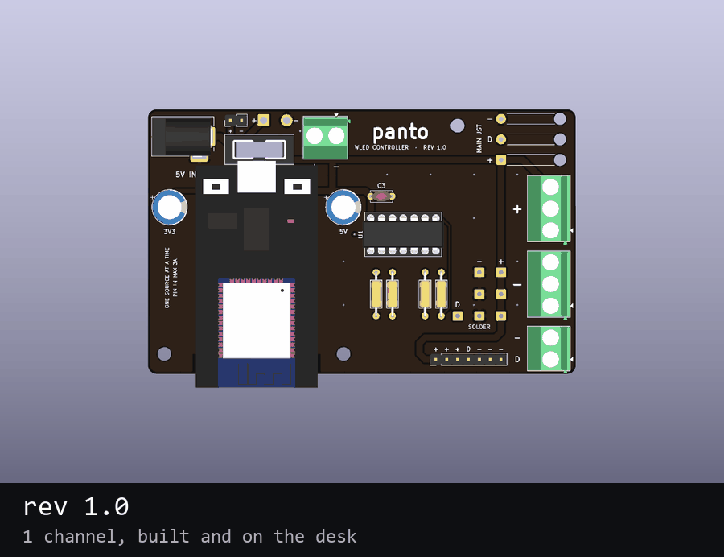
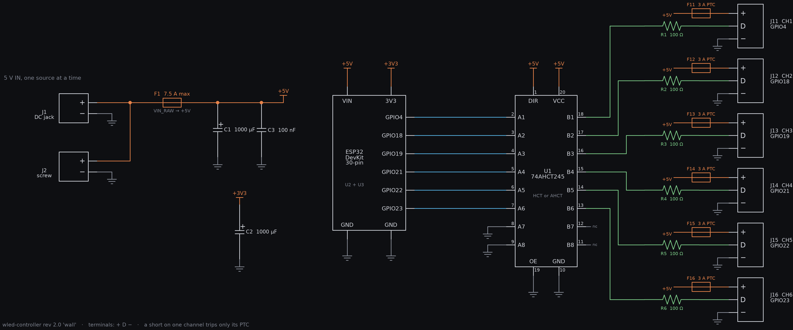

# wled-controller

Carrier boards for an ESP32 DevKit (30-pin) running WLED with 5 V addressable strips
(WS2812B), plus printed mounts for them. The boards are generated by Python scripts against
KiCad's API, routed by a small A* router written for them, and the printed mounts are
checked for collisions against the boards' STEP models, including while the board slides in.

| | State | Where |
|---|---|---|
| rev 1.0, 1 channel | built, on the desk | [rev1/](rev1/README.md) |
| rev 2.0 `wall`, 6 channels | **current design, ready to order** | [rev2/](rev2/README.md) |
| wall mount for `wall` | designed, not printed | [enclosure/wall/](enclosure/wall/README.md) |
| base and slide-in case for rev 1.0 | printed | [enclosure/rev1/](enclosure/rev1/README.md) |

## Schematic (rev 2.0 `wall`)

[SVG](docs/schematic-wall.svg). The board is generated from code without a KiCad schematic, so
`rev2/schematic.py` draws this from a net list and `schematic.py --check` compares that list
with the routed board pad by pad (28 nets, 0 differences on 2026-10-20).

## Folders

| Folder | What is in it |
|---|---|
| `jlc/` | the one file to upload to JLCPCB |
| `rev1/` | rev 1.0: generator, router, KiCad board, STEP, Gerbers, renders, BOM |
| `rev2/` | rev 2.0: generator (`--size wall`, the old layouts still build), router, the `wall` board, its STEP, renders, back-side art in `art/` |
| `rev2/old-variants/` | layouts that were drawn and dropped: `phi` (6 ch with JST-XH), `phi4` (4 ch, status LEDs), `120`, `100` |
| `enclosure/` | printed parts, one folder per board |
| `purchases/` | costs, TME quick-buy lists (`quickbuy-v2-wall.txt` is the current one), the cost sheet |
| `footprints/`, `3d/` | footprints and stand-in 3D models shared by both revisions |
| `backups/` | WLED config and presets from the desk controller (local only, not in the repository) |

## Ordering the `wall` board at JLCPCB

Upload `jlc/wled-controller-v2-wall-gerbers.zip`: both copper, mask and silkscreen layers, the
outline and one Excellon drill file. (Locally there is also an `-art` zip with back-side art,
see [rev2/](rev2/README.md); that one is not in the repository.) JLC reads the size from the outline:
100 × 61.8 mm, inside their cheapest 100 × 100 mm bracket.

| Option | Choice |
|---|---|
| Layers | 2 |
| Thickness | 1.6 mm |
| Solder mask | black |
| Silkscreen | white |
| Surface finish | HASL lead-free is enough (no bare-copper art on this version) |
| Copper | 1 oz |
| Mark on the board | JLC prints an order number somewhere unless told otherwise; choose the option that removes it or fixes its place (check the form for its price) |

The board passed KiCad's DRC with 0 violations and 0 unconnected items (2026-10-20), with
0.2 mm clearance and 0.4 mm tracks, both inside JLC's standard limits. Optional back
art is made of 0.25 mm dots; JLC's minimum silkscreen line is 0.15 mm.

TME parts: `purchases/quickbuy-v2-wall.txt`. The rest was already on hand: 100 Ω resistors,
100 nF, two 1000 µF capacitors, the DC jack, a 2-pole 5.08 mm terminal, a 3 A blade fuse.
