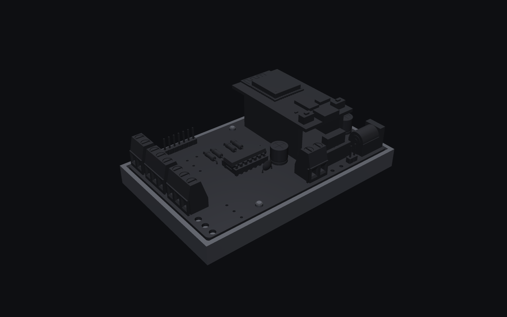
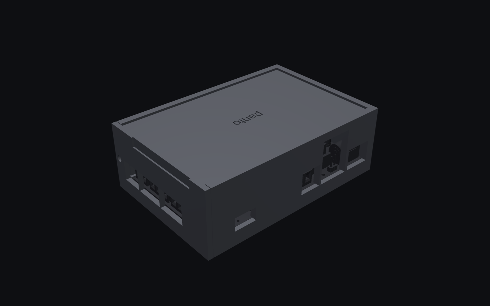
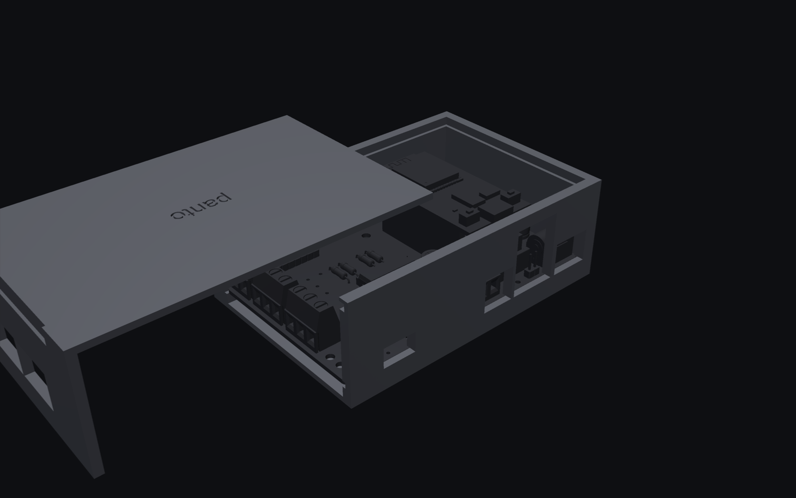

# Enclosure and base (rev 1.0 board)

Two options, both PLA:

- **base**: an open tray with three posts whose pegs go through the board's holes H1-H3. No
  screws or inserts: the board drops on and lifts off, stays fully visible, and every
  connector is free. For the desk.
- **enclosure**: a closed two-part case. The board slides in on rails, the lid slides in
  over it and closes the open end, one M3 screw holds the lid. For behind a TV.






Closed: 107.3 × 72.4 × 36.2 mm.

## Parts

| File | Print | Notes |
|---|---|---|
| `fit-test-body.stl`, `fit-test-lid.stl` | first, a few minutes | the output end of both parts: rails, lid grooves, insert block, screw hole |
| `body.stl` | upright, open side up, no supports | |
| `lid.stl` | top face on the bed, end plate up, no supports | |
| `base.stl` | upright, no supports | 105 × 66.8 × 9.5 mm; 3.0 mm pegs for the 3.2 mm holes (`PEG_D`) |

Plus one M3 brass heat-set insert (up to 5.7 mm long, 4.0 mm hole), one M3 × 8 screw and
four 10 mm stick-on rubber bumpers (recesses in the floor). Printed feet would make the
floor print on four points, so there are none.

## Assembly

1. Melt the insert into the hole in the body's output end (Pinecil with an M3 insert tip,
   about 200-225 °C for PLA): 90 % with the tip, the last bit pressed flat with the tip off.
2. Slide the board in at the open (output) end, the edge without terminals first, until it
   stops at the closed end.
3. Slide the lid in the same way; its end plate covers the terminals except their wire
   entries.
4. Screw it to the insert.

The screw terminals' clamping screws are under the lid: wire the outputs, then close it.

## Fits

All clearances are named constants at the top of `enclosure.py`: the board slot is 2.1 mm
for a 1.6 mm board, the rails leave 0.4 mm per side, the length 0.8 mm, the lid 0.6 mm in
height and 0.4 mm per side. If the fit test is tight or loose, change the constant and
regenerate; nothing else needs touching.

The model is built in KiCad's frame, whose y axis points down the screen, so that frame is a
mirror image of the real board; `real()` in `enclosure.py` mirrors every part once on export.
The renders use the exported parts.

`check.py` loads the board's STEP (with the DevKit raised 6 mm, as built on two stacked
female headers) and checks every part against body, lid and base, in place and at every 4 mm
of the way in. It exits 1 on any overlap.

```
pip install build123d pyvista
python enclosure.py      # STL + STEP
python check.py          # 0 overlaps expected
python render.py         # renders/
```
