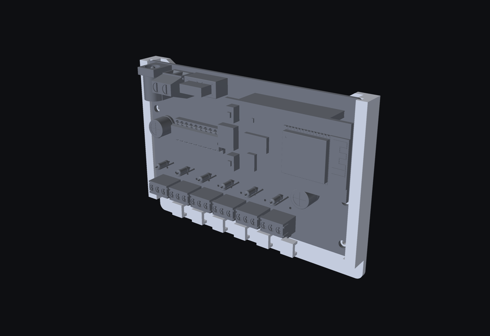
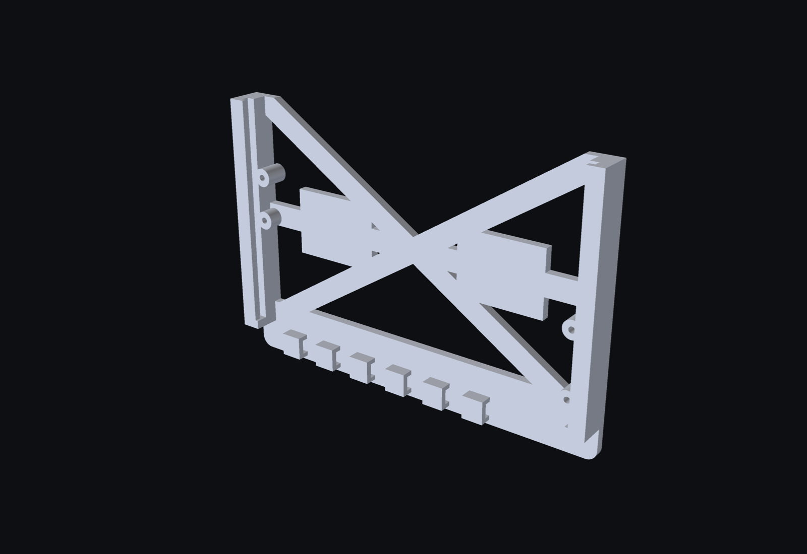
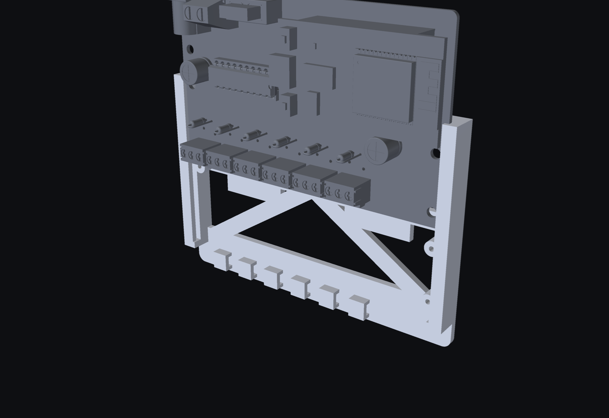

# Wall mount (rev 2.0 `wall` board)

An open frame with a flat back: a rail down each side, an X brace between them, a middle
bar through the crossing of the X with two 24 × 18 mm pads for double-sided tape, and a bottom bar with a cable-tie block
under each of the six outputs. The board drops in from the top, slides down in the rails'
grooves and sits on stops at the bottom. The front is open, so the whole board shows.






106.4 × 73.5 × 9.7 mm (without the board). One part. 15.7 cm³ solid, about 19 g of
PLA at 100 % infill and less with normal infill; rev 1.0's solid base took about 50 g.

## Against rev 1.0's base

| rev 1.0 base | this mount |
|---|---|
| board loose on three pegs | both long edges held in grooves, 0.2 mm play per side in x |
| no rails | board slides in from the top, stops at the bottom |
| tips when the right side is pressed | four posts under H1-H4 hold the board up when a terminal screw or plug pushes it |
| | last 12 mm of each groove close to 1.65 mm for the 1.6 mm board: pressed in, no rattle |

The posts pass under the board's own lead columns on the way in; `check` tests that every
4 mm of the slide (the `wall` board's holes were placed for that).

## Print

- `wall-fit-test.stl` first: the bottom 17 mm with both grooves, the pinch and the stops.
  Slide the bare board in from the top of it.
- `wall.stl`: back face on the bed, no supports (the groove lips are 1.2 mm overhangs, the
  tie tunnels 4 mm bridges). PETG black or PLA black from the filament shelf.
- Tape: thin double-sided foam tape on the two pads on the middle bar.
- Screws: four M2 x 8 through the board's mounting holes into the posts. Each post has a
  1.7 mm hole all the way through, so the screw cuts its own thread in the plastic (or tap
  it M2 first); the post is 6.4 mm tall, exactly what is left of the screw past the 1.6 mm
  board, so the tip ends flush with the back and does not touch the wall.

## Fits

All in the constants at the top of `wall.py`: `SLOT_PLAY_Z` (groove 1.9 mm), `PINCH_Z`
(closes to 1.65 mm over `PINCH_L`), `SLOT_PLAY_X` (0.2 mm per side), `LIP`, `POST_D`. Tight
on the fit test → lower `PINCH_Z`; loose → raise it. Regenerate and nothing else changes.

```
pip install build123d pyvista
python wall.py           # wall.stl, wall-fit-test.stl, wall.step
python wall.py check     # 0 overlaps expected, in place and at every 4 mm of the slide
python wall.py render    # renders/wall-*.png
```

The board STEP is `../../rev2/wled-controller-v2-wall.step` (`kicad-cli pcb export step
--subst-models`). Built in KiCad's mirrored frame like `../enclosure.py`; `real()` mirrors on
export. Not printed yet.
