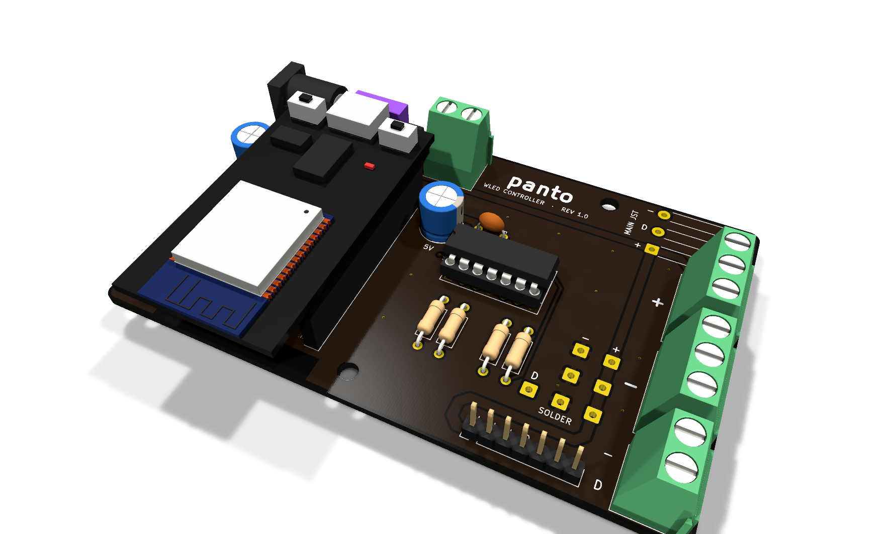

# wled-controller rev 1.0 (built, on the desk)

A 100 × 61.8 mm (golden rectangle) two-layer carrier board for an ESP32 DevKit (30-pin) running WLED
with 5 V addressable LED strips (WS2812B and similar). It follows the classic
WLED wiring diagram by @DedeHai: fused 5 V input, bulk capacitors on 5 V and
3.3 V, a 74AHCT125 level shifter and series data resistors.



Prices and where to buy: [BOM.md](BOM.md). Rev 2.0: [../rev2/](../rev2/README.md). Enclosure and desk base: [../enclosure/rev1/](../enclosure/rev1/README.md).

## What is on the board

- **Power input** (all in parallel, before the fuse; use one at a time):
  DC jack 5.5/2.1 mm, 2-pin screw terminal, solder pads, 2-pin header (max 3 A).
- **F1**: mini blade fuse, sized to the power supply (3 A for a 5 V / 3 A PSU).
- **ESP32 DevKit** in two 1×15 female headers, 25.4 mm row spacing, USB-C facing the top edge,
  3V3 capacitor on the left, VIN capacitor on the right.
- **U1 74AHCT125**: GPIO4 (D4) drives all four buffers, and each has its own series resistor:
  - MAIN: solder pads with strain relief for a JST SM pigtail (+, D, −)
  - SCREW: separate blocks on the right edge: 3× +, 3× −, and a D + − pair
  - SOLDER: D, 3× −, 3× +
  - PINS: 7-pin header `+ + + D − − −`
- Back silkscreen: "panto" (optional pixel-art outline with `--gear path.png`).
- GND pours on both layers and a copper keepout under the ESP32 antenna.

## Bill of materials

| Ref | Part | Qty |
|---|---|---|
| U1 | SN74AHCT125N (DIP-14). **Must be AHCT or HCT**, plain HC will not work | 1 |
| — | DIP-14 socket | 1 |
| U2, U3 | Female header 1×15, 2.54 mm | 2 |
| C1, C2 | 1000 µF 16 V electrolytic, Ø8 mm, 5 mm pitch | 2 |
| C3 | 100 nF ceramic (MLCC), 5 mm pitch | 1 |
| R1–R4 | 100 Ω 0.25 W axial (33–200 Ω works) | 4 |
| F1 | Mini blade fuse holder, Keystone 3568 footprint, plus 3 A mini blade fuse | 1 |
| J1 | DC barrel jack 5.5/2.1 mm, PCB mount (DC-005 style) | 1 |
| J2, J6–J8 | Screw terminals 5.08 mm: 2× 3-pole, 2× 2-pole | 4 |
| J4, J12 | Male pin header 1×2 and 1×7 | 1 each |
| J5 | JST SM 3-pin pigtail (female side soldered into the board) | 1 |
| H1–H4 | M3 standoffs (optional) | 4 |

## Regenerating

`gen_board.py` builds the unrouted board with KiCad's bundled Python:

```
"C:/Program Files/KiCad/10.0/bin/python.exe" gen_board.py --gear path/to/gear.png
```

It **overwrites** `wled-controller.kicad_pcb`, so do not run it after routing has started.
Set `KICAD10_FOOTPRINT_DIR` if KiCad is installed somewhere else.

## 3D model

The 3D view shows the chip in its socket, a 3 A fuse and a stand-in ESP32 DevKit
(KiCad's WROOM-32 model on simple boxes from `../3d/make_boxes.py`). The stand-in is the
`ESP1` footprint: board-only, no pads, excluded from BOM and position files.
`gen_board.py --mask Purple` changes the solder mask colour used by the 3D view.

## Routing

`route.py` is a small grid A* router (numpy, KiCad's bundled Python). It routes every
net except GND, which the pours on both layers pick up, then adds GND stitching vias:

```
cp wled-controller.unrouted.kicad_pcb wled-controller.kicad_pcb
"C:/Program Files/KiCad/10.0/bin/python.exe" route.py
kicad-cli pcb drc --refill-zones --save-board wled-controller.kicad_pcb
```

Power nets are 1.5 mm (VIN_RAW, +5V) and 1.0 mm (+3V3), signals 0.4 mm.
`wled-controller-gerbers.zip` holds the Gerbers and drill file for the fab.

## Before ordering

- Measure your ESP32's row spacing and compare the pin labels on the silkscreen with
  your board. `ESP_ROW_SPACING` in the script sets the spacing.
- Import `wled-controller.step` into your CAD tool to design an enclosure around it.
- Check the polarity of the DC plug with a multimeter. The board expects centre positive.
- In WLED, set the LED output to GPIO4 and cap the current limit at about 2500 mA for a 3 A supply.

## Rev 1.0 build notes (2026-10-14)

Board #1 was hand-soldered and drives a strip without flicker. Problems found on the way,
as input for v2:

- **Fuse holder under the ESP32.** The KEYS3568 holder sits under the overhanging end of
  the DevKit, so the ESP32 needs a second layer of female headers to clear it. The extra
  contact made VIN unreliable (the board only worked while the ESP32 was pushed sideways);
  bending the extra header's VIN leg slightly fixed it. v2: every tall part outside the
  ESP32 outline, one contact between module and board.
- **Cold joints on the power pins.** The first pads of both header rows (3V3, VIN, GND)
  sit on wide power traces and pour; at normal iron temperature the solder did not wet.
  v2: thermal reliefs on those pads, or solder them at 360-370 °C.
- **White solder mask** shows flux residue and turns yellow around joints. Pick black or
  green.
- **Lead time.** A month of waiting for one board order; order at least 2-3 sets of every
  part, and more than one board revision in the same order when possible.
- **Strip cable.** The board should not hang behind the desk: add a 0.5 m JST SM 3-pin
  extension.

## v2 ideas

- at least 4 independent outputs (separate GPIOs, not copies of one signal), possibly
  room for two ESP32 boards;
- fuse moved away from the module, ideally a main fuse plus protection per output;
- connectors that do not need hand-made pigtails.
