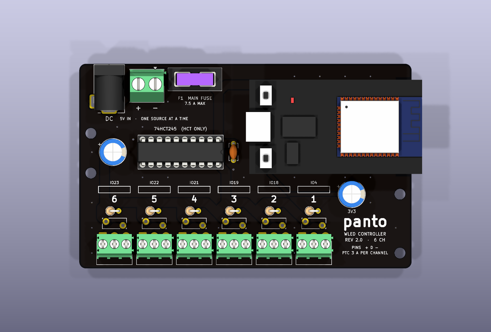
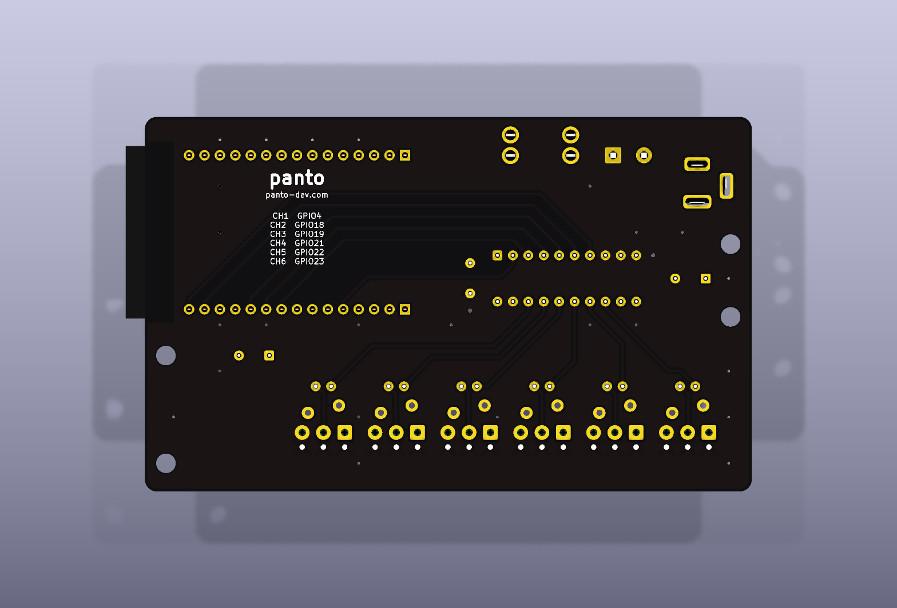
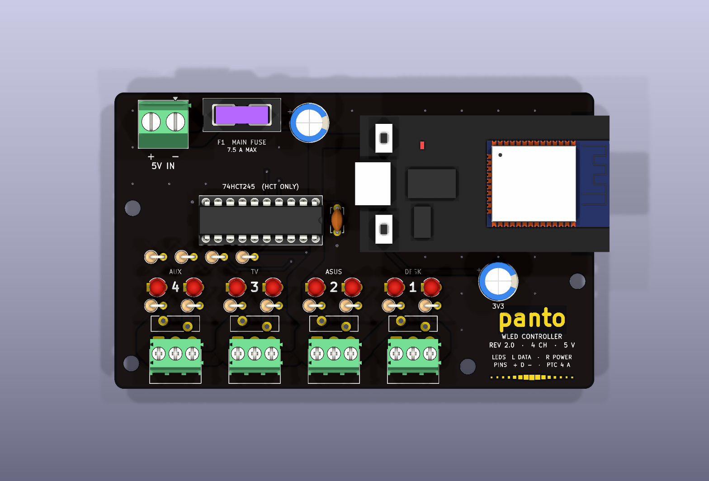

# wled-controller rev 2.0

Rev 2.0 drives several strips from one ESP32 DevKit (30-pin) through a 74(A)HCT245. Every
output has its own screw terminal, polyfuse and series resistor; one channel shorting trips
its polyfuse and the others keep running.

**The board to order is `wall`** (`--size wall`, files `wled-controller-v2-wall.*`, Gerbers in
`../jlc/`). The other layouts were drawn first and dropped; their boards, renders and Gerbers
are in `old-variants/`. `gen_board.py --size <x>` still builds any of them, into this folder.

## `wall` (2026-10-20, the one to order)

100 × 61.8 mm, six channels along the bottom edge, numbered right to left.




| CH | 1 | 2 | 3 | 4 | 5 | 6 |
|---|---|---|---|---|---|---|
| GPIO | 4 | 18 | 19 | 21 | 22 | 23 |

- **Per channel:** XY302R 3-pole screw terminal at the bottom edge (pins `+ D -`), RG300-16
  polyfuse (3 A hold, 5.1 A trip), 100 Ω standing resistor, the channel number, its GPIO, and
  an empty box to write the strip's name in. No JST sockets: the strips' JST SM pairs come
  with leads, and the lead goes straight into the terminal, so no cable is soldered or
  crimped; the strip unplugs at its SM connector.
- **Inputs:** the DC jack (5.5/2.1, turned so the plug goes in from the top edge, the open
  end of the wall mount) and the 2-pole screw terminal J2 next to it, in parallel before the
  main blade fuse F1. One source at a time. J2 is for a bigger supply later; the jack has no
  current rating at TME.
- **Main fuse:** 7.5 A at most (track rating, see Power); with the current 3 A supply use the
  spare 3 A fuse.
- **Shifter:** SN74HCT245N or SN74AHCT245N in a socket (HC does not work: it does not see
  3.3 V as high at 5 V). The two unused buffers have their inputs on GND.
- **Nothing tall under the DevKit.** The DevKit sits on one 8.5 mm female header plus its own
  2.5 mm pin plastic, so its underside is 11 mm above the board. C1 (EEUFR1C102L, 11.5 mm
  tall) sits left of the shifter; only the DevKit's own sockets are inside its outline.
- **Mounting holes** H1-H4 at (3.5, 21.0), (3.5, 33.0), (96.52, 39.37), (96.52, 57.15): the
  wall mount's posts, placed where nothing below them passes over a post while the board
  slides in.
- **Back:** "panto", panto-dev.com and the channel to GPIO table. Optional back art:
  `python art/make_art.py picture.png` dithers any picture onto a 0.25 mm grid
  (`art/silk-runs.json`); `gen_board.py --size wall --art art/silk-runs.json` then builds
  `wled-controller-v2-wall-art`, with the art mirrored onto the back silkscreen and cut away
  round every pad and hole pixel by pixel, and `route.py --size wall --art` routes it. The
  board Panto orders carries a wallpaper that is not his to publish, so the picture, the
  `-art` board and its Gerbers stay out of this repository. Silkscreen art costs nothing extra
  at JLC: it is the same white layer.
- **Outputs:** `python fab.py wled-controller-v2-wall` writes `../jlc/<name>-gerbers.zip`
  (fails if no drill file came out), the STEP and the renders.
- Routed by `route.py --size wall`: DRC 0 violations, 0 unconnected (2026-10-20). The strip
  terminals' GND pins join the pours solid (they carry the strip current, and the tracks
  starved their thermal spokes).

## `phi4` (dropped 2026-10-20, in `old-variants/`)

Kept for the record; Panto rejected the status LEDs, the gold logo and pixel row, the
hard-coded channel names and the four channels. Its XY302R footprint, wall-mount edge margins
and solid terminal GND carried over to `wall`.


Same 100 × 61.8 mm outline as `phi` (JLC's cheapest bracket), cut down to what the desk and
the TV need, with room for status LEDs and a wall mount (`../enclosure/wall/`):

| CH | GPIO | Strip | LEDs |
|---|---|---|---|
| 1 DESK | 4 | desk, segments as on rev 1.0 | 72 |
| 2 ASUS | 18 | monitor top and sides, from the 1.6 m left over | ~40 |
| 3 TV | 19 | TV perimeter 2 × 91 + 2 × 53 cm, new strip | ~86 |
| 4 AUX | 21 | spare | |

What changed against `phi`:

- **4 channels, not 6.** Three are used; the fourth is a spare. Each cell is 16.5 mm wide
  instead of 12.
- **No JST-XH sockets.** The strips plug in through JST SM pairs, and the pair's pigtail goes
  into the screw terminal, so a strip still unplugs at its SM connector with no hand-made
  leads. JST SM has no PCB socket (wire-to-wire series).
- **No DC jack.** Power comes in through J2 only (Mean Well GST60A05-P1J, 5 V 6 A, through a
  DC-plug-to-screw-terminal adapter). The PC-GK2.1 jack has no current rating at TME, and the
  left edge has to be free for the mount's rail.
- **XY302R terminals with their own footprint**
  (`../footprints/wled.pretty/TerminalBlock_Xinya_XY302R-3_P3.50mm_Horizontal`). From the
  Xinlaiya drawing: pins 0.9 × 0.5 mm (1.03 mm diagonal, fits the 1.2 mm drill), 0.7 mm from
  the back face, body 9.2 mm deep. The pads match KiCad's Phoenix PT footprint, but the body
  does not: on the Phoenix footprint an XY302R would overhang the board edge by about 3 mm.
  The wire entries now end 1.2 mm inside the bottom edge.
- **4 A polyfuses** (`RG400-16`: 4 A hold, 6.8 A trip, same 5.1 mm pitch) and 2.0 mm V_CHn
  tracks, so the TV strip is not capped at 3 A.
- **Two status LEDs per channel**, 3 mm through-hole: yellow DATA on the left, green PWR on
  the right. PWR (10 kΩ from V_CHn) shows that the channel's polyfuse passes current: dark
  means tripped or no input. DATA (470 Ω) hangs on one of the 74HCT245's four spare buffers,
  whose inputs copy that channel's GPIO, so the LED never loads the strip's data line. It
  glows while WLED sends frames (dimly: a frame is a few ms) and stays dark when nothing is
  sent. Values chosen from what is on hand (parts-inventory: 470 Ω × 10, 10 kΩ × 20,
  5 green, 5 yellow); a brighter PWR LED is 1 kΩ.
- **Look:** black mask, ENIG, the logo and a row of 15 "pixels" sized like the desk's fill-in
  wave are bare copper with the mask opened, so they come out gold. Channel names on the
  front, the channel → GPIO → name table on the back.
- **C2 moved 5 mm right** so the mount's post under H4 does not run into its lead while the
  board slides in.

Routed by `route.py --size phi4`, DRC 0 violations, 0 unconnected (2026-10-20). The strip
terminals' GND pins and the LED cathodes join the pours solid, not through thermal spokes:
the router's tracks starved their spokes, and the terminal GND carries the strip current.
Gerbers: `old-variants/wled-controller-v2-phi4-gerbers.zip`. TME list: `../purchases/old/quickbuy-v2-phi4.txt`.



WLED settings for this board: LED Preferences, four outputs (GPIO 4, 18, 19, 21), "Use
per-output limiter" on, a limit per output under the 4 A polyfuses: TV 3500 mA, desk
2500 mA, ASUS 1000 mA. With the per-output limiter WLED has no separate total (its settings
page shows the sum, 7000 mA here), so the 6 A supply is kept by the interlock planned in rice:
the desk group (CH1 + CH2, 3500 mA) and the TV (3500 mA) never light at once.

## Power

`VIN_RAW` and `+5V` are 2.6 mm tracks on 1 oz outer copper: about 6.5 A at a 20 °C rise and
7.8 A at 30 °C (IPC-2221). The main fuse is therefore 7.5 A at most, printed next to F1 on the
`phi` board. 3 mm tracks no longer routed on `phi` (15 unconnected), 2.6 mm does with DRC
clean (2026-10-16). TME gives no current rating for the PC-GK2.1 jack; small barrel jacks are
usually a few amps, so heavy loads should come in through the screw terminal J2. The `120` and
`100` boards were not regenerated with the wider tracks.

Renders: `kicad-cli pcb render --use-board-stackup-colors --floor --background opaque ...`
(without `--use-board-stackup-colors` the black mask comes out olive).

## What changed from rev 1.0

From the rev 1.0 build notes:

- **Main fuse outside the module.** F1 sits in the input row and nothing tall is under the
  DevKit, so the module sits in one female header row, one contact.
- **Thermal reliefs everywhere**, the ESP32's GND and power pins included. The router also
  keeps a wider ring free around GND pads, so their spokes into the pours survive.
- **Black solder mask** in the stackup.
- **No hand-made pigtails.** Each channel has a PCB-mounted JST-XH 3-pin socket next to its
  screw terminal.
- **Independent outputs.** Each channel has its own GPIO, buffer, resistor and polyfuse,
  where rev 1.0 had one GPIO driving four copies.

Inputs are the DC jack and a 5.08 mm screw terminal, in parallel before F1. The solder pads
and the pin header input are gone.

## Parts for the old `phi` board (6 channels with JST-XH), TME, 2026-10-16

Prices are gross PLN from the TME API, at the quantity in the table,
which is TME's minimum where that is more than the board needs. Nothing was ordered.

| Ref | Part | TME symbol | Qty | PLN |
|---|---|---|---|---|
| U1 | 74HCT245, DIP-20. **HCT or AHCT**: plain HC does not see 3.3 V as high at 5 V | `SN74HCT245N` | 1 | 2.70 |
| — | DIP-20 socket | `1-2199298-6` | 1 | 2.29 |
| F1 | Mini blade fuse holder | `KEYS3568` | 1 | 4.80 |
| — | Mini blade fuse 7.5 A, at most (see Power) | `029707.5WXNV` | 2 | ~3.4 |
| F11-F16 | Polyfuse 3 A hold, 5.1 A trip, 16 V, 5.1 mm pitch (fits the MF-RG300 footprint) | `RG300-16` | 6 | 8.19 |
| J11-J16 | Screw terminal 3.5 mm, 3-pole, horizontal | `XY302R-3P-3.5-GN` | 6 | 7.76 |
| J21-J26 | JST XH 3-pin socket, vertical | `B3B-XH-A` | 6 | 2.97 |
| R1-R6 | 100 Ω 0.25 W, mounted standing | `CF1/4W-100R` | 100 | 4.03 |
| C1, C2 | 1000 µF 16 V, Ø8 mm, 5 mm pitch (C2 on 3V3) | `EEUFR1C102L` | 2 | 7.90 |
| C3 | 100 nF ceramic, 5 mm pitch | `CC-104/100` | 100 | 17.11 |
| J1 | DC jack 5.5/2.1 (footprint in `../footprints`) | `PC-GK2.1` | 3 | 5.26 |
| J2 | Screw terminal 5.08 mm, 2-pole | `TB-5.08-P-2P/BL` | 5 | 6.61 |
| U2, U3 | Female header 1×40, cut into two 1×15 | `ZL262-40SG` | 2 | 4.47 |
| | **Total** | | | **77.51** |

Without what is left over from rev 1.0 (resistors, 100 nF, DC jacks, 2-pole terminals,
headers, 1000 µF capacitors, a spare fuse holder) the new parts come to about 27 PLN:
74HCT245, socket, fuses, polyfuses, 3.5 mm terminals and XH sockets. Shipping and the PCB
are on top. The 120 and 100 boards need 8 of each per-channel part.

Notes:

- The footprint is Phoenix PT 1,5/3-3,5-H, which TME lists (`PT1.5/3-3.5-H`, 3.92 PLN) but
  had 0 in stock; XY302R is the in-stock 3.5 mm alternative. Its hole and pad sizes are not
  checked against the Phoenix footprint yet. "1,5" in the Phoenix name is the 1.5 mm² wire
  rating; strip leads (AWG 22-18, 0.3-0.8 mm²) fit.
- The strips' own connectors are **JST SM**, a wire-to-wire series (JST's SM datasheet:
  "wire-to-wire connectors"); there is no SM socket for a PCB. The board has JST **XH**
  sockets, which take an XH plug, so each strip needs an SM-to-XH adapter lead.
- MF-RG300 (the footprint's part) is not at TME; RG300-16 has the same 5.1 mm pitch and
  1.2 mm lead offset.

Pin order on every terminal and socket is `+ D -` (pad 1 is +).

## Generating

KiCad 10's bundled Python, one size at a time:

```
"C:/Program Files/KiCad/10.0/bin/python.exe" gen_board.py --size phi
"C:/Program Files/KiCad/10.0/bin/python.exe" route.py --size phi
kicad-cli pcb drc --refill-zones --save-board wled-controller-v2-phi.kicad_pcb
```

`gen_board.py` overwrites the board. `route.py` is rev 1.0's grid A* router without its
hand-drawn presets. It lays a few GND stubs first (C3, U1's GND pin, the ESP32's GND pins),
routes every net, adds GND stitching vias, then fills the pours and routes a GND track to
any GND pad that tracks closed off from the main pour on both layers. All three boards:
every net routed, DRC 0 violations, 0 unconnected (2026-10-16).

## Log, 2026-10-16

- Started from rev 1.0's generator and router; added the channel strip, the three layouts
  (`--size`), the ESP32 on its side for `phi`, and unused '245 inputs tied to GND.
- Fixed on the way: floating GND copper (island removal on, 0.5 mm minimum pour width),
  C3's GND pad and the ESP32's GND pins fenced in (GND stubs before routing), U1's GND pin
  closed in on the 120 board (U1 turned 90 there, so its input row faces the ESP32).
- Mask colour `#0A0A0CF0` instead of "Black": KiCad renders its "Black" brown. JLC's black
  mask is black either way.
- C1 is Ø8 like C2, so rev 1.0's 1000 µF 16 V capacitors fit both.
- Open: check XY302R against the footprint, pick the board (Panto leans to `phi`), a base
  for it (rev 2.0's holes are not where rev 1.0's are), and maybe per-channel LEDs.

The 3D view uses the stand-in DevKit models from `../3d`. The polyfuses have no 3D model.
